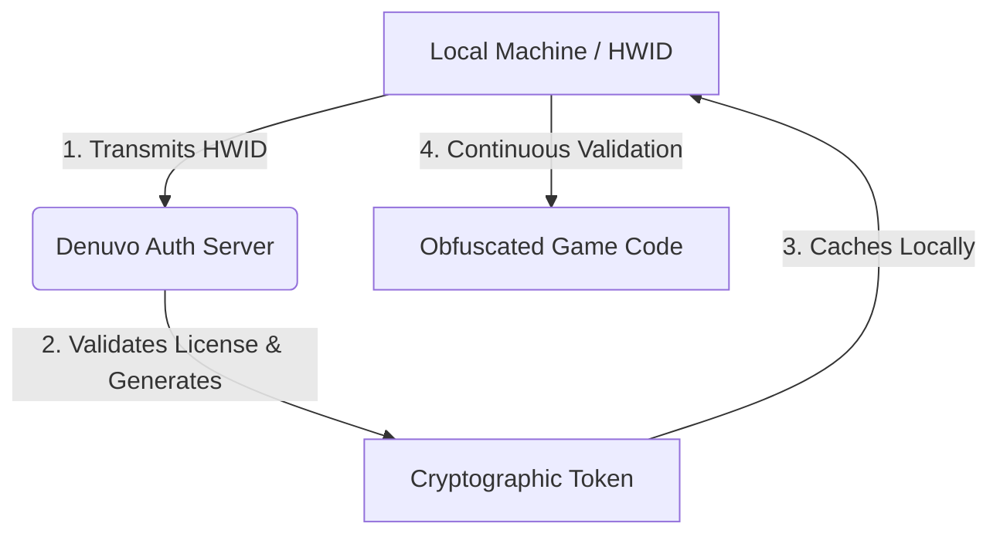

# 🛡️ Denuvo DRM: Architectural Mechanics & Activation Flow

## 📌 Executive Summary
**Denuvo Anti-Tamper** is a Digital Rights Management (DRM) system designed to prevent the reverse engineering and unauthorized modification of software. Instead of replacing existing DRM platforms (like Steam or Epic Games Store), it integrates directly into the binary file of an application to act as an obfuscation and validation layer.

---

## 🔄 The Activation Flow (Setup Phase)
During the initial launch or major system updates, **an active internet connection is strictly required**. The process follows a specific cryptographic handshake between the local machine and the remote authentication server:

1. **Hardware Fingerprinting:** The local Denuvo client scans specific physical components (CPU, motherboard, GPU) to generate a unique digital signature representing the machine's **Hardware ID (HWID)**.
2. **Server Handshake:** The application sends this HWID payload over the internet to the central **Denuvo Server** to verify license authenticity.
3. **Token Generation:** Upon successful validation, the remote server generates a cryptographically signed **Activation Token** bound explicitly to that specific HWID.
4. **Local Storage:** The token is returned to the computer and cached locally on the storage drive, allowing the application to run.

---

## 🏗️ Core Architectural Concepts

### 🔑 1. Token Validation & Offline Play
* **Dynamic Verification:** During execution, the application routinely checks the local machine's current hardware state against the cryptographic token. If they match, the code executes normally.
* **Token Expiration:** To prevent token cloning and account sharing, local activation tokens have a built-in time-to-live (TTL). 
* **Re-authentication Triggers:** An internet connection is re-required to refresh the token when:
	* The built-in expiration timer lapses (typically days or weeks).
	* Major hardware components are upgraded or replaced.
	* Operating system updates alter low-level system files.

### 💻 2. Binary Obfuscation & Virtualization
* **Deep Code Integration:** Denuvo does not sit "around" the game like a shell; it hooks deeply into vital assembly execution paths (e.g., instructions handling game logic or rendering loops).
* **Custom Virtual Machines:** Critical segments of native x86/x64 assembly code are compiled into a proprietary, non-standard bytecode. This bytecode runs inside a customized virtual interpreter, making static analysis and debugging incredibly difficult for reverse engineers.
* **Continuous Integrity Checks:** The software constantly performs anti-debugging, anti-hooking, and memory-tampering checks to ensure the application environment has not been modified.

---

> [!NOTE] Key Takeaway
> Denuvo does not encrypt the entire game. Instead, it uses **server-verified tokens bound to your HWID** to unlock and continuously validate heavily obfuscated, virtualized entry points within the application's executable code.
> 