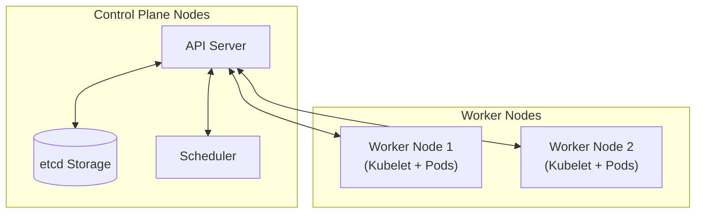
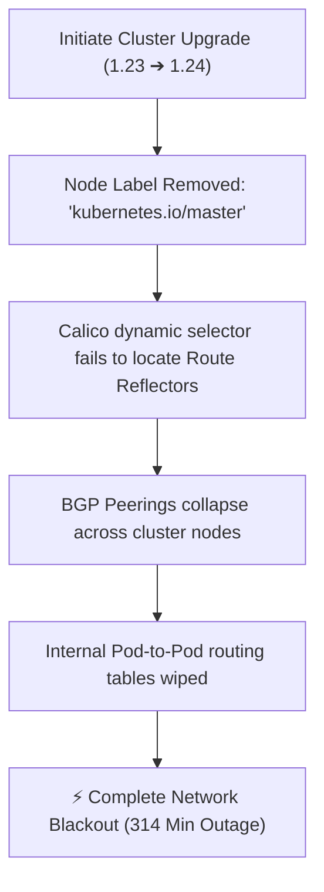

# Kubernetes Crash Course & Core Architecture

> [!abstract] Overview
> Notes based on the [Kubernetes Outage Breakdown](https://youtu.be/J3VavGnt5Yg) video covering K8s primitives, control plane architecture, network interfaces, BGP routing, and real-world failure modes.

---

## 1. What Kubernetes Really Is

Kubernetes (Greek for *"helmsman"* or *"pilot"*, often abbreviated as **K8s**) is an **open-source container orchestration tool** originally developed by Google. 

Its primary purpose is to manage large clusters of servers (nodes) and the applications running on them by automating operational tasks:
* **Automated Deployment & Rollouts:** Managing container lifecycles safely.
* **Auto-Scaling:** Scaling workloads dynamically up or down based on resource usage.
* **Self-Healing:** Automatically restarting failed containers, replacing broken nodes, and rescheduling workloads.
* **Networking & Load Balancing:** Distributing traffic across healthy application instances.

---

## 2. Core Building Blocks

> [!definition] Key Concepts
> * **Container:** A lightweight, standalone package containing an application alongside its runtime, dependencies, libraries, and configurations.
> * **Cluster:** A collection of physical or virtual machines working together under Kubernetes management to run containerized workloads.

### Node Architecture

> [!info] Types of Nodes
> * **Control Plane Nodes (formerly Master Nodes):** Dedicated control nodes running administrative services. They maintain cluster state, make scheduling decisions, and handle cluster-level events.
> * **Worker Nodes:** The physical or virtual servers executing application workloads encapsulated inside **Pods**.

---

## 3. Control Plane Components

> [!component] Core Architecture Breakdown
>
> ### [[API Server]] (`kube-apiserver`)
> * **Role:** Central communications gateway.
> * **Function:** Exposes the Kubernetes API. Every interaction—whether from CLI tools like `kubectl`, external control panels, or internal system daemons—passes through the API server.
>
> ### [[etcd]]
> * **Role:** Cluster state store.
> * **Function:** A consistent and highly available key-value database that acts as the single source of truth for all cluster metadata, configurations, secrets, and status metrics.
>
> ### [[Scheduler]] (`kube-scheduler`)
> * **Role:** Workload assigner.
> * **Function:** Watches for newly created Pods without assigned nodes. Evaluates CPU/memory requirements, affinity rules, and node constraints to select the optimal worker node.
>
> ### [[Kubelet]]
> * **Role:** Node execution agent.
> * **Function:** Runs on every worker node to execute commands from the API server, interface with the container runtime (e.g., `containerd`), and continuously report health status.

---

## 4. Kubernetes Networking & CNI

> [!note] CNI Requirement
> Kubernetes mandates that **every Pod gets its own IP address** and must be able to communicate with all other Pods across nodes without Network Address Translation (NAT). Implementation is delegated to **CNI Plugins**.

* **[[Calico]]:** An open-source CNI plugin that uses native Layer-3 routing rather than overlay networks (like VXLAN) for higher performance and networking policy enforcement.
* **[[BGP]] (Border Gateway Protocol):** The standard internet routing protocol utilized by Calico. Each node advertises its local Pod IP ranges to ensure all nodes maintain accurate routing paths.
* **[[Route Reflectors]]:** In large clusters ($100+$ nodes), direct peer-to-peer BGP mesh creates $O(n^2)$ connection overhead. Route Reflectors act as centralized routing hubs, receiving updates from nodes and broadcasting them out to optimize connections.

---

## 5. Case Study: Reddit Outage Analysis

> [!warning] Outage Incident Summary
> During a Kubernetes upgrade from version `1.23` to `1.24`, Reddit suffered a **314-minute major service outage** due to a silent configuration failure.

> [!example] Root Cause Analysis
> 1. **The Legacy Configuration:** Calico Route Reflectors were configured to discover control plane nodes dynamically using the legacy selector `kubernetes.io/master`.
> 2. **The Breaking Change:** Kubernetes `1.24` permanently removed the `master` node label in favor of `node-role.kubernetes.io/control-plane`.
> 3. **The Result:** As nodes upgraded, Calico lost track of all Route Reflectors. BGP sessions failed, wiping routing tables and preventing containers across nodes from communicating with each other.

---

