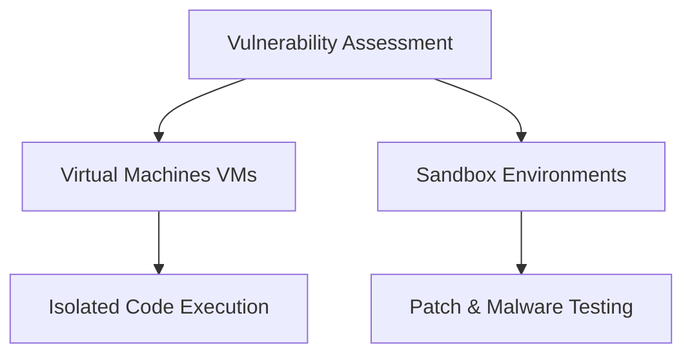
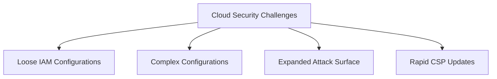

# Network Security Core Notes: DoS, Packet Sniffing, and IP Spoofing

## 1. Denial of Service Attacks (DoS & DDoS)

### Basic Concepts

- **DoS (Denial of Service)**: An attack targeting a network or server by flooding it with network traffic to disrupt normal business operations. The goal is to overwhelm a network device so it crashes or cannot respond to legitimate users, costing time and money while exposing the target to further vulnerabilities.
    
- **DDoS (Distributed Denial of Service)**: A DoS attack utilizing multiple devices or servers across different locations to flood the target, making it far more likely to overwhelm the server.
    
- **Nature of the Attack**: In DoS, the attacker wins if _any_ part of the network is overloaded. This can occur via raw traffic volume or via carefully crafted packets designed to force hardware (like routers) to expend excessive processing time.
    

### Common Network-Level DoS Attacks

|**Attack Name**|**Protocol**|**Mechanism**|**Core Impact**|
|---|---|---|---|
|**SYN Flood**|TCP|Exploits the TCP three-way handshake (`SYN` $\rightarrow$ `SYN/ACK` $\rightarrow$ `ACK`). The attacker floods the server with `SYN` requests without completing the final handshake step.|Leaves ports open and exhausts available server ports, preventing legitimate connections.|
|**ICMP Flood**|ICMP|Repeatedly sends ICMP packets to a target server, forcing it to generate corresponding ICMP replies.|Consumes all available inbound and outbound bandwidth, causing the server to crash.|
|**Ping of Death**|ICMP|Sends an oversized ICMP packet exceeding the standard maximum limit of **64 KB**.|Overloads vulnerable systems during packet reassembly/processing, crashing the target (analogous to dropping a large rock on an anthill).|

## 2. Packet Sniffing & Protocol Analyzers

### What is Packet Sniffing?

- Data packets contain a **header** (source/destination IP addresses) and a **body** (payload such as personal information, credentials, or financial data).
    
- Packet sniffing is the practice of using software or hardware tools to intercept and inspect data packets as they travel across a network.
    
- Used legitimately by security analysts to investigate incidents, troubleshoot, and baseline traffic, but also used maliciously to spy on unauthorized communications.
    

### Operational Modes

- **Passive Packet Sniffing**: The attacker reads packets in transit without altering them (comparable to a mail carrier reading personal mail inside an envelope). Common on hub networks where all traffic is visible to all connected hosts.
    
- **Active Packet Sniffing**: The attacker alters packets in transit, modifies payload data (such as bank details), or injects protocols to reroute traffic to unintended ports.
    
- **Promiscuous Mode**: By default, a Network Interface Card (NIC) only accepts packets destined for its own MAC address. In promiscuous mode, the NIC accepts all network traffic passing through the physical medium.
    

### Common Protocol Analyzer Tools

- **SolarWinds NetFlow Traffic Analyzer**
    
- **ManageEngine OpManager**
    
- **Azure Network Watcher**
    
- **Wireshark**
    
- **tcpdump**
    

### Focus Tool: tcpdump

> A popular, lightweight, command-line network protocol analyzer built on the open-source `libpcap` library, preinstalled on many Linux distributions and available on macOS/Unix systems.

- **Standard Output Fields**:
    
    - **Timestamp**: Time format (hours, minutes, seconds, fractions of a second).
        
    - **Source IP & Port**: Originating device address and port number.
        
    - **Destination IP & Port**: Target device address and receiving port number.
        
    - _Default behavior_: Attempts to resolve IPs into hostnames and port numbers into corresponding service names.
        
- **Core Analyst Use Cases**: Establishing network baselines, identifying unauthorized traffic/access points, detecting malicious payloads, and configuring custom alerts.
    

## 3. IP Spoofing & Related Attacks

### Fundamentals

IP spoofing occurs when an attacker alters the source IP address in a packet header to impersonate a trusted or authorized system. This technique is used to bypass firewall rules that filter external traffic and hide the attacker's true origin.

### Common IP Spoofing Attack Variations

```
                  ┌──► On-path Attack (Man-in-the-Middle / Data intercept / DNS spoofing)
                  │
IP Spoofing ──────┼──► Replay Attack (Delaying or repeating captured authentication traffic)
                  │
                  └──► Smurf Attack (Hybrid DoS / Broadcast amplification via ICMP)
```

#### 1. On-Path Attack (Meddler-in-the-Middle)

- The attacker positions themselves between two communicating endpoints (e.g., a web browser and a web server).
    
- Sniffs packets to discover communicating IP and MAC addresses, then impersonates either endpoint.
    
- **DNS Spoofing Risk**: Intercepts DNS queries and returns falsified IP records, redirecting users to malicious domains.
    

#### 2. Replay Attack

- The attacker intercepts valid network transmissions and intentionally delays or repeats them later.
    
- Used to desynchronize communication sessions or impersonate an authorized entity by replaying past authentication exchanges.
    

#### 3. Smurf Attack

- A hybrid attack combining **IP spoofing** and **DDoS amplification**.
    
- The attacker spoofs the victim's IP address and sends ICMP Echo requests to a network's **broadcast address**.
    
- Every active device on that network segment sends an ICMP Echo Reply back to the spoofed victim address simultaneously, exhausting victim bandwidth and processing resources.
    

## 4. Prevention & Defensive Measures

### Defense-in-Depth Approach

No single security control stops all network attacks; defenses must be layered across protocols, infrastructure, and endpoints.

- **Data-in-Transit Encryption**:
    
    - Implement **HTTPS (SSL/TLS)** and **VPNs**.
        
    - Even if packets are intercepted via active/passive sniffing, the payload remains unreadable to eavesdroppers.
        
- **Firewall Ingress Filtering**:
    
    - Configure firewall rules to reject incoming traffic from external interfaces that claim an internal/private source IP address.
        
    - Deploy **Next-Generation Firewalls (NGFW)** capable of anomaly detection to identify broadcast storms and Smurf attack signatures.
        
- **Network Hygiene**:
    
    - Avoid unencrypted, open public Wi-Fi networks unless an encrypted VPN tunnel is established before transmitting sensitive credentials.


🔍 1. Understanding Brute Force Attacks

A **brute force attack** is a trial-and-error process used by malicious actors to discover private credentials. While tedious when done manually, attackers frequently leverage automated tools to scale their efforts.

Attack Vectors

- **Simple Brute Force Attacks**
    - Attackers guess login credentials by entering combinations of usernames and passwords until one works.
- **Dictionary Attacks**
    - Attackers utilize a pre-compiled list of commonly used passwords and stolen credentials from previous breaches.
    - _Historical Context:_ Originally named because they used literal dictionary word lists before complex password rules became standard.

---

🧪 2. Assessing Vulnerabilities

Organizations proactively identify security gaps and simulate incidents using isolated testing environments before a live breach occurs.




Use code with caution.

💻 Virtual Machines (VMs)

> [!INFO] Definition  
> **Virtual Machines (VMs)** are software-emulated versions of physical computers that run in isolated environments.

- **Key Benefits:**
    - **Isolation:** Prevents malicious code from leaking into the host operating system.
    - **Disposability:** Can be completely deleted and replaced with a pristine image post-testing.
    - **State Control:** Allows analysts to snapshot and revert to a clean, previous state.

> [!warning] Virtualization Risk  
There is a small, persistent risk that advanced malware can perform a **virtualization escape** to access and comprom ise the underlying host machine.

🏜️ Sandbox Environments

- **Purpose:** Isolated environments built specifically to execute untrusted software, test security patches, find bugs, and simulate attack scenarios.
- **Deployment:** Can be standalone physical hardware, but cloud-based or software-driven VMs are more cost-effective.
> [!ATTENTION] Evasion Tactics  
    > Modern malware authors write code capable of detecting VM or sandbox environments. If detected, the malware alters its behavior to appear completely harmless.
    

---

🛡️ 3. Prevention & Defensive Measures

Operating system hardening requires a defense-in-depth approach combining cryptographic techniques and strict access management.

Technical Controls

- **Salting & Hashing**
    - `Hashing`: A one-way cryptographic function that converts data into a unique fixed-length value. It cannot be decrypted back into plain text.
    - `Salting`: Inserts random characters into the password before hashing, exponentially increasing hash complexity and resisting pre-computed crack lists.
- **Identity Verification**
    - `MFA`: Requires \(\ge 2\) distinct authentication factors (e.g., something you know like a password, and something you are like a fingerprint).
    - `2FA`: A subset of MFA utilizing exactly two forms of verification.

Perimeter & Administrative Controls

- **CAPTCHA & reCAPTCHA**
    - _Completely Automated Public Turing test to tell Computers and Humans Apart_.
    - Challenges users with simple tasks to distinguish humans from automated scripts, effectively blocking bot-driven brute-forcing.
- **Password Policies**
    - Standardizes corporate password hygiene by enforcing strict rules:
        - Complexity and character requirements
        - Maximum password age (rotation intervals)
        - Password history/reuse prohibitions
        - **Account lockout thresholds** (suspending access after \(X\) failed attempts)


🔍 1. Cloud Security Considerations

While cloud computing delivers speed, cost savings, and scalability, it also introduces distinct architectural and security complexities.




Use code with caution.

🆔 Identity & Access Management (IAM)

- **Definition:** The framework of processes and tech used to manage digital identities and authorize resource permissions.
> [!WARNING] The Principle of Least Privilege  
    > A primary cloud vulnerability is the **loose configuration of user roles**. Over-permissioned roles permit unauthorized actions, dramatically widening an organization's risk profile.
    

⚙️ Configuration & Attack Surface

- **Complexity Management:** Every individual cloud service requires precise configuration to maintain compliance. Migration phases are historically prone to misconfiguration vulnerabilities.
- **Attack Surface Dynamics:** Deploying numerous applications increases potential entry points for malware.
> [!TIP] Good News on Infrastructure  
    > If designed correctly, multi-service architectures do not inherently yield more entry points. Cloud Service Providers (CSPs) generally enforce default configurations that are under much greater security scrutiny than traditional on-premises setups.
    

🕒 Zero-Day Attacks & Visibility

- **Zero-Day Advantages:** CSPs operate at a scale that allows them to discover zero-day exploits before private enterprises do. They seamlessly patch hypervisors and migrate active workloads away from threats.
- **The Visibility Trade-off:**
    - **Available Tools:** Cloud networks provide deep visibility via **flow logs** and **packet mirroring**.
    - **Third-Party Audits:** Because CSPs block direct inspection of their physical backend servers, they pay for independent third-party audits to verify systemic compliance and reveal on-premise integration gaps.

---

🤝 2. The Shared Responsibility Model

The shared responsibility model creates an explicit boundary defining where the security tasks of the provider end and those of the customer begin.

```
┌───────────────────────────────────────────────────────────┐
│               CUSTOMER: Security IN the Cloud             │
│  (Data, IAM Configurations, Apps, Operating Systems)      │
├───────────────────────────────────────────────────────────┤
│                  CSP: Security OF the Cloud               │
│  (Physical Data Centers, Hypervisors, Host Infrastructure) │
└───────────────────────────────────────────────────────────┘
```

> [!CAUTION] The Assumptions Trap  
> Security breaches frequently happen when organizations assume a CSP is securing an asset that actually falls under the customer's jurisdiction (e.g., leaving a database publicly exposed due to default setup oversight).

---

🛠️ 3. Cloud Security Hardening Framework

Securing cloud assets relies on a blended approach of administrative governance, physical boundary protection, and data security controls.

- **IAM Enforcement:** Tightening permission scopes and audit logs.
- **Hypervisor Security:** Relying on the provider's isolated virtual engine boundaries.
- **Baselining:** Establishing a trusted state of "normal" configuration and network behavior metrics to identify anomalies early.
- **Cryptography & Cryptographic Erasure:** Encrypting active data pools and using cryptographic erasure (destroying encryption keys) to permanently sanitize cloud storage when decommissioning resources.

---
---
# Course 4 - Module 1
Introduction to Operating Systems (OS)
What is an Operating System?

- **Definition**: The interface that bridges the communication gap between computer hardware and the user.
- **Core Purpose**: Makes computers run as efficiently as possible while ensuring they are easy for humans to use.
- **Key Concept**: Translates human interactions into **binary** (the computer's native language of 0s and 1s).

Hardware vs. Software Evolution

- **Hardware**: Refers to the physical components of a computer.
- **The 1950s Challenge**: Early computers lacked an OS interface and could not run multiple programs simultaneously. Users had to wait for a program to finish, reset the computer, and manually load the next one.
- **Modern OS Capabilities**: Today's systems run multiple applications at once and seamlessly manage external devices like printers, keyboards, and mice.

Common Operating Systems

- **Desktop/Laptop**: Windows, macOS, and Linux.
- **Mobile (Smartphones/Tablets)**: Android and iOS.
- **Security Industry**: **Linux** is highly popular and a primary tool for security professionals.

The Role of OS Security

Operating system security protects and prevents threats such as **viruses, worms, and malware**. It focuses on securing:

- Files
- Data access
- User authentication

Security Analyst Responsibilities

A deep understanding of the OS is required to perform critical security tasks, including:

- Configuring and maintaining system security by managing access.
- Managing and configuring firewalls.
- Setting security policies.
- Enabling virus protection.
- Performing auditing, accounting, and logging to detect unusual behavior.

## Operating systems and vulnerabilities

Security issues are inevitable with all operating systems. An important part of protecting an operating system is keeping the system and all of its components up to date.

### **Legacy operating systems**

A **legacy operating system** is an operating system that is outdated but still being used. Some organizations continue to use legacy operating systems because software they rely on is not compatible with newer operating systems. This can be more common in industries that use a lot of equipment that requires embedded software—software that’s placed inside components of the equipment.

Legacy operating systems can be vulnerable to security issues because they’re no longer supported or updated. This means that legacy operating systems might be vulnerable to new threats.
