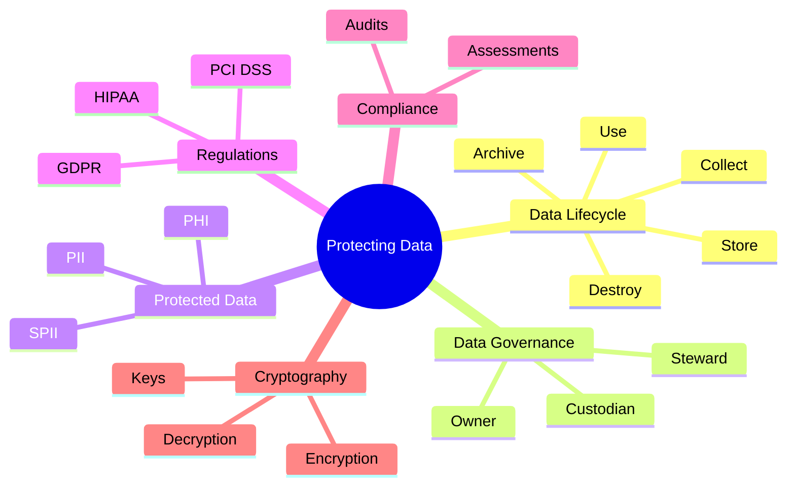
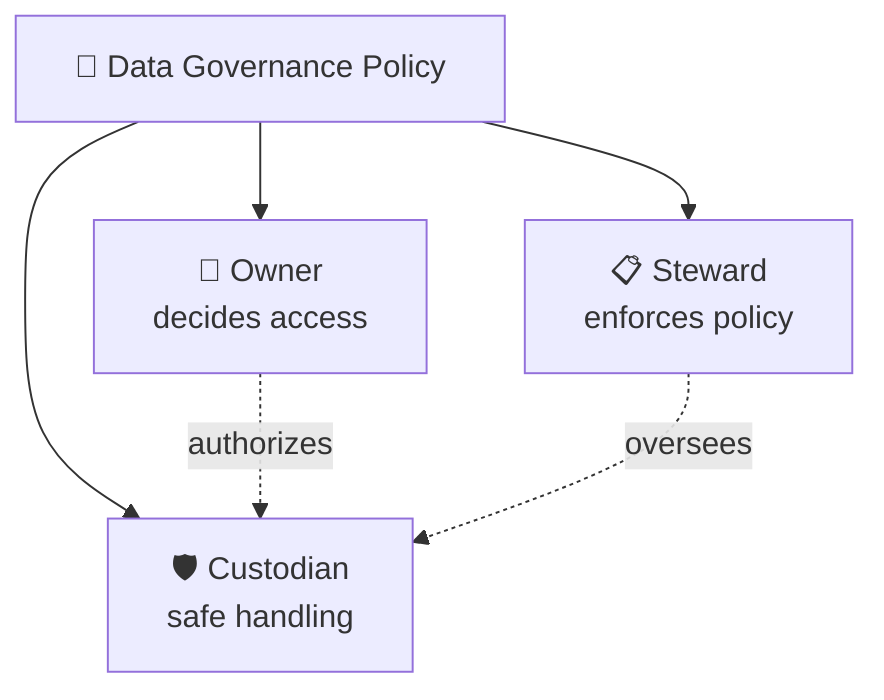
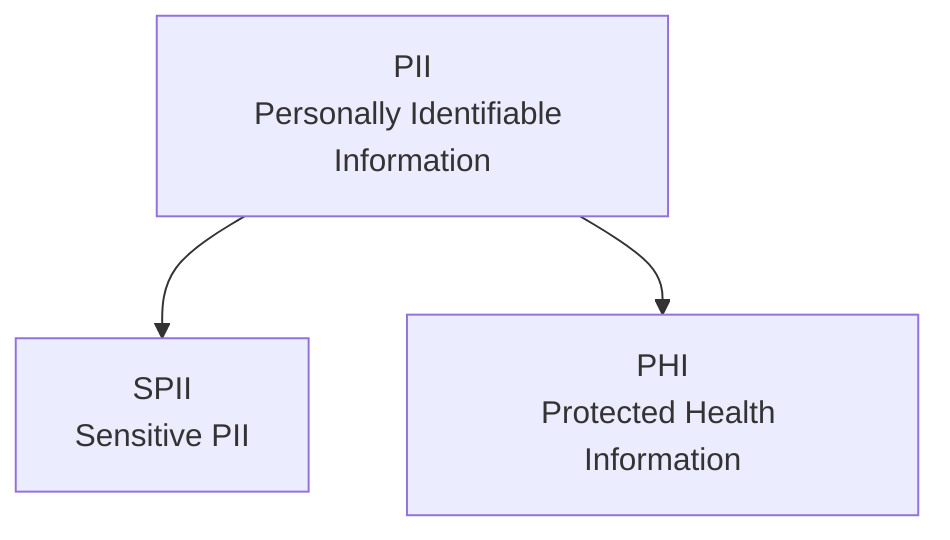
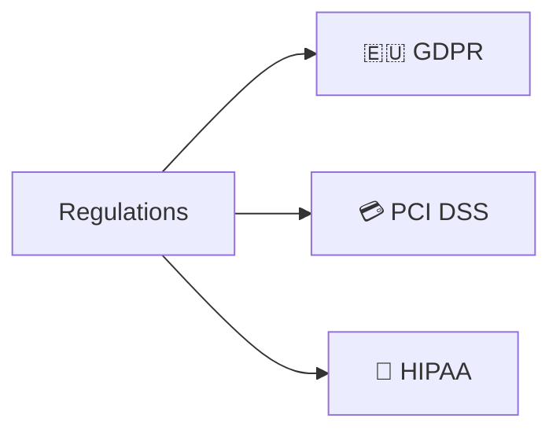
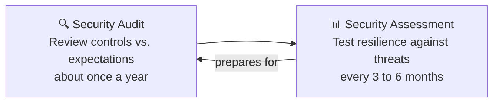
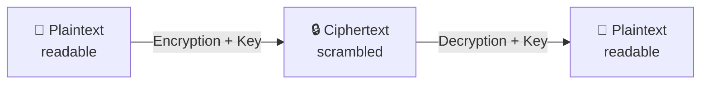
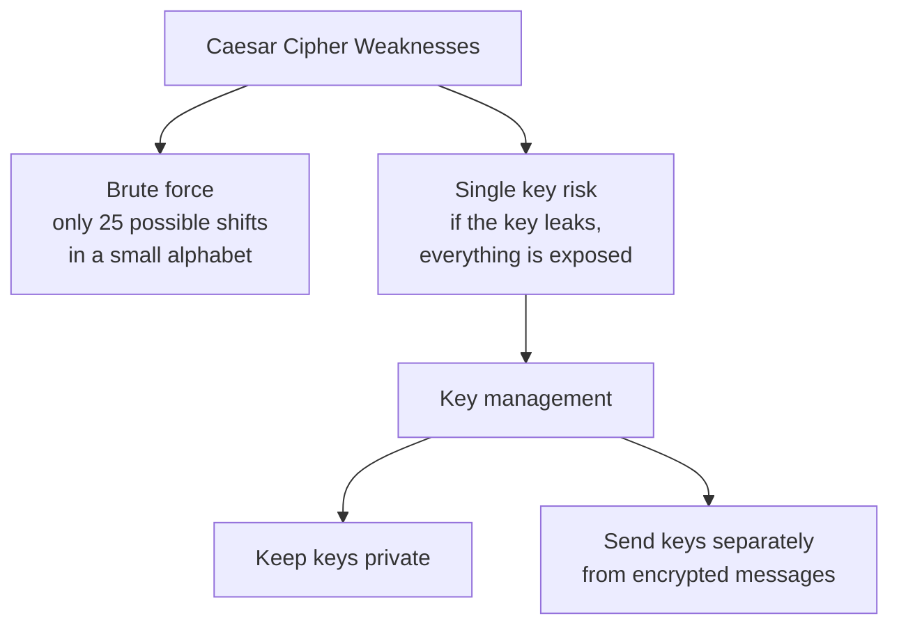

## Question

What are the elements of security risk planning? Select three answers.

Threats

Correct

Security risk planning involves the analysis of three elements: assets, threats, and vulnerabilities. A threat is any circumstance or event that can negatively affect assets, such as a burglar stealing money from a cash register.
**Threats** are circumstances or events that can negatively impact assets. There are many different types of threats. However, they are commonly categorized as two types: intentional and unintentional.
For example, an _intentional_ threat might be a malicious hacker who gains access to sensitive information by targeting a misconfigured application. An _unintentional_ threat might be an employee who holds the door open for an unknown person and grants them access to a restricted area. Either one can cause an event that must be responded to.

Assets

Correct

Security risk planning involves the analysis of three elements: assets, threats, and vulnerabilities. An asset is an item perceived as having value to an organization, such as a cash register and the money inside it.

Vulnerabilities

Correct

Security risk planning involves the analysis of three elements: assets, threats, and vulnerabilities. A vulnerability is a weakness that can be exploited by a threat, such as an unlocked door to a restricted area.
**Vulnerabilities** are weaknesses that can be exploited by threats. There’s a wide range of vulnerabilities, but they can be grouped into two categories: technical and human.

For example, a _technical_ vulnerability can be misconfigured software that might give an unauthorized person access to important data. A _human_ vulnerability can be a forgetful employee who loses their access card in a parking lot. Either one can lead to risk.


a **risk** is anything that can impact the confidentiality, integrity, or availability of an asset. Since organizations have particular assets that they value, they tend to differ in how they interpret and approach risk.

One way to interpret risk is to consider the potential effects that negative events can have on a business. Another way to present this idea is with this calculation:

**Likelihood x Impact = Risk**

# Asset Management & Classification

> [!quote] Core Philosophy _"You can only protect what you know you have."_

## 1. Overview & Importance

**Asset management** is the systematic process of identifying, tracking, and managing the risks affecting organizational assets. To design an effective security perimeter and keep operational friction low, organizations must maintain an accurate inventory.

### Key Asset Types

|   |   |   |
|---|---|---|
|**Category**|**Description**|**Examples**|
|**Digital Assets**|Electronic data and records|Customer PII, financial ledgers, transactional logs|
|**Information Systems**|Processing environments & infrastructure|Networks, cloud infrastructure, enterprise software|
|**Physical Assets**|Tangible property and gear|Data centers, office facilities, laptops, servers|
|**Intangible Assets**|Non-physical organizational value|Intellectual property (IP), brand reputation, trade secrets|

## 2. Fundamentals of Asset Classification

Asset classification is the practice of labeling assets based on their **sensitivity** and **criticality** to the organization.

### The 4 Core Questions of Classification

An organization must answer four foundational questions for every asset:

1. **What do you have?** _(Identity & description)_
    
2. **Where is it?** _(Physical location, host, or cloud storage region)_
    
3. **Who owns it?** _(Accountability and governance)_
    
4. **How important is it?** _(Business impact analysis / criticality)_
    

> [!tip] Business Benefits
> 
> - **Risk Prioritization:** Focuses high-cost defensive resources on the most critical targets.
>     
> - **Cost Optimization:** Prevents over-spending on protecting low-risk assets.
>     
> - **Regulatory Compliance:** Satisfies audit and legal frameworks (e.g., ISO/IEC 27001, SOC 2, HIPAA).
>     

## 3. Standard Classification Schemes

```
▲ Restricted      (Need-to-know / Highest Sensitivity)
│ Confidential    (Significant business damage if leaked)
│ Internal-Only   (Employees & trusted business partners)
▼ Public          (Zero impact if disclosed)
```

|   |   |   |   |
|---|---|---|---|
|**Classification Level**|**Sensitivity**|**Access Scope**|**Impact of Breach / Disclosure**|
|**🔴 Restricted**|Highest|Strictly "Need-to-Know"|Catastrophic damage or extreme legal liability.|
|**🟠 Confidential**|High|Authorized personnel|Significant negative financial, reputational, or operational impact.|
|**🟡 Internal-Only**|Moderate|Employees & authorized partners|Minor operational disruption; not meant for public viewing.|
|**🟢 Public**|Lowest|General public|Negligible / No negative consequences.|

> [!note] Sector Variability Commercial naming schemes differ from government sectors. In government frameworks (e.g., US DoD), classifications follow schemes like _Confidential_, _Secret_, and _Top Secret_, where _Confidential_ is often the lowest classified tier rather than an intermediate one.

## 4. Key Classification Challenges

> [!warning] Friction Points in Practice

### A. Ambiguous Asset Ownership

- Ownership of physical infrastructure (like real estate or main servers) is clear, but personal computing devices blur lines.
    
- **Example:** A corporate laptop assigned to a remote worker containing both proprietary company code and the employee's personal documents/photos.
    

### B. Mixed Classification Data (Data Aggregation)

- Single documents or payloads often combine varying levels of sensitivity.
    
- **Example:** A postal delivery or billing statement:
    
    - _Recipient Name:_ Public / low sensitivity.
        
    - _Mailing Address / Account Balance:_ Confidential / restricted.


# Cloud Computing & Cloud Security

> [!quote] Definition: Cloud Computing (UK NCSC) _"An on-demand, massively scalable service, hosted on shared infrastructure, accessible via the internet."_

## 1. The Cloud Computing Shift

Historically, launching digital products required building and maintaining expensive, on-premises back-end infrastructure.

### Core Drivers of Cloud Adoption

- **Scalability:** Scale workloads rapidly up or down based on traffic.
    
- **Agility:** Accelerate development life cycles and deploy instantly.
    
- **Cost Efficiency:** Shift from upfront capital expenditure (CapEx) on physical servers to flexible operational expenditure (OpEx).
    
- **The Trade-off:** While simplifying operations, cloud environments introduce complex shared-tenancy attack surfaces and distributed governance risks.
    

## 2. Cloud Service Models

Cloud solutions generally fall into three service tiers depending on the level of customer control vs. provider management:

```
▲ User Control
│
│  [ IaaS ]  Infrastructure (Virtual machines, networking, raw storage)
│  [ PaaS ]  Platform (Runtime environments, developer build tools)
│  [ SaaS ]  Software (Turnkey applications delivered via browser)
▼
```

|   |   |   |   |   |   |
|---|---|---|---|---|---|
|**Model**|**Full Name**|**Primary Focus**|**Customer Responsibility**|**Provider Responsibility**|**Representative Examples**|
|**SaaS**|Software as a Service|End-user applications|Data access policies, user credentials, end-point devices|App uptime, patching, runtime, infrastructure|Gmail, Slack, Zoom|
|**PaaS**|Platform as a Service|Application development & hosting|Application code, data, app-level configurations|Hardware, OS, runtime environment, network security|Google App Engine, Heroku, VMware Cloud Foundry|
|**IaaS**|Infrastructure as a Service|Foundational infrastructure|Operating systems, runtime, firewall configs, storage, apps|Physical hardware, physical data center security, virtualization hypervisors|AWS EC2, Google Cloud Platform (Compute), Azure VMs|

## 3. The Shared Responsibility Model

Moving to the cloud replaces traditional perimeter defense with a partnership model between the **Cloud Service Provider (CSP)** and the **Customer**.

```
Traditional (On-Prem)           Cloud (Shared Model)
┌───────────────────────┐       ┌───────────────────────┐
│ Everything managed by │  ───▶ │ Customer: Data / IAM  │
│ customer's internal   │       ├───────────────────────┤
│ security team         │       │ CSP: Infrastructure   │
└───────────────────────┘       └───────────────────────┘
```

### Customer Scope (Direct Control)

- **Identity & Access Management (IAM):** Who gets access to which resource and under what conditions.
    
- **Resource Configuration:** Hardening network security groups, object storage buckets, and access ports.
    
- **Data Security & Handling:** Encryption at rest, encryption in transit, data retention, and classification.
    

> [!tip] Rule of Thumb The amount of security responsibility delegated to the CSP increases as you move from **IaaS** $\rightarrow$ **PaaS** $\rightarrow$ **SaaS**. However, **data classification, identity management, and credential protection always remain the customer's responsibility.**

## 4. Key Cloud Security Challenges

> [!warning] Critical Vulnerabilities & Risks

1. **Misconfiguration (Primary Threat Vector):**
    
    - Relying on default "out-of-the-box" settings that leave public write/read permissions enabled (e.g., exposed storage buckets).
        
2. **Cloud-Native Breaches:**
    
    - Exploits targeting misconfigured IAM roles, API gateways, and cloud service metadata endpoints.
        
3. **Visibility & Access Monitoring:**
    
    - Distributed workloads make it challenging to maintain unified log ingestion and behavioral auditing across hybrid/multi-cloud setups.
        
4. **Regulatory & Compliance Demands:**
    
    - Auditing cross-border data residency and privacy mandates (e.g., **GDPR**, **HIPAA**, **PCI DSS**) in distributed multi-tenant environments.


Three States of Data Protection

- **Data in Use:** This refers to data actively being accessed by users, such as checking emails on a laptop.
- **Data in Transit:** This is data moving from one point to another, like sending an email.
- **Data at Rest:** This describes data that is not currently being accessed and is typically stored on a physical device, such as a closed laptop.


# Security Culture, Plans, and the NIST Cybersecurity Framework (CSF)

> [!quote] Core Philosophy
> 
> **Security is all about people, processes, and technology.**
> 
>   
> 
> It is not just an IT task—it is an organizational culture built on shared values spanning employees, vendors, and customers.
> 
>   

## 1. Security Plans: Policies, Standards, and Procedures

Security plans exist to prepare organizations for risks affecting the **Confidentiality, Integrity, and Availability (CIA triad)** of assets. Operationalizing these plans relies on three hierarchical elements:

  

```
┌───────────────────────────────────────────────┐
│                   POLICIES                    │  Strategic: What & Why
└───────────────────────┬───────────────────────┘
                        │ informs
┌───────────────────────▼───────────────────────┐
│                  STANDARDS                    │  Tactical: Points of Reference
└───────────────────────┬───────────────────────┘
                        │ dictates
┌───────────────────────▼───────────────────────┐
│                  PROCEDURES                   │  Operational: Step-by-Step
└───────────────────────────────────────────────┘
```

|**Component**|**Nature**|**Primary Role**|**Concrete Example**|
|---|---|---|---|
|**Policies**|**Strategic**|Foundational rules that set the scope, goals, and boundaries of what to protect and why.|**Acceptable Use Policy (AUP)** governing permitted corporate network and hardware usage.|
|**Standards**|**Tactical**|Benchmark requirements and objective references used to shape enforceable policies.|Mandating minimum 8-character passwords referencing **NIST SP 800-63B**.|
|**Procedures**|**Operational**|Step-by-step technical instructions for carrying out specific tasks consistently.|Standard operating procedure (SOP) for resetting a locked user account.|

## 2. Compliance vs. Frameworks

Understanding the distinction between mandatory constraints and voluntary guidelines is critical for security governance:

  

- **Regulations**: Mandatory rules created by governments or regulatory authorities (e.g., HIPAA, GDPR, PCI DSS). Failure to comply can result in severe financial fines, legal prosecution, and brand destruction.
    
      
    
- **Compliance**: The ongoing act of adhering to both internal standards and external regulatory mandates.
    
      
    
- **Frameworks**: Voluntary, structured collections of guidelines, baselines, and best practices designed to help organizations manage risk and reach target compliance levels.
    
      
    

> [!tip] Framework vs. Regulation
> 
>   
> 
> - **Regulations** are legally mandatory requirements you **must** follow.
>     
>       
>     
> - **Frameworks** (like NIST CSF) are structured blueprints you **choose** to use to systematically meet those legal and business objectives.
>     
>       
>     

## 3. NIST Cybersecurity Framework (CSF) Architecture

Originally created in 2014 by the National Institute of Standards and Technology to safeguard U.S. critical infrastructure, the CSF is widely adopted globally across both public and private sectors.

  

The CSF is composed of **three pillars**:

  

### Pillar 1: The Core (Functions)

The CSF Core represents key cybersecurity outcomes organized into **6 Functions** (updated in CSF 2.0 to include _Govern_):

  

```
       ┌──────────────┐
       │    GOVERN    │  <-- Cross-cutting: Strategy, oversight & policy
       └──────┬───────┘
  ┌───────────┼───────────┐
  │           │           │
┌─▼────────┐┌─▼────────┐┌─▼────────┐
│ IDENTIFY ││ PROTECT  ││  DETECT  │
└──────────┘└──────────┘└──────────┘
  │           │           │
  └───────────┼───────────┘
       ┌──────┴───────┐
       │   RESPOND    │
       └──────┬───────┘
       ┌──────▼───────┐
       │   RECOVER    │
       └──────────────┘
```

- **Govern (GV)** _(Added Feb 2024)_: Establishes organizational context, cybersecurity strategy, risk tolerance, and governance oversight.
    
      
    
- **Identify (ID)**: Determines critical systems, assets, data, and risk environments (asset tracking, risk assessment).
    
      
    
- **Protect (PR)**: Implements safeguards to secure asset delivery and limit cyber event impacts (access control, training, data security).
    
      
    
- **Detect (DE)**: Surfaces the occurrence of anomalies, indicators of compromise, and unauthorized activities.
    
      
    
- **Respond (RS)**: Directs the containment, investigation, and mitigation actions taken once an incident is detected.
    
      
    
- **Recover (RC)**: Restores capabilities, infrastructure, and resilience post-incident.
    
      
    

### Pillar 2: Implementation Tiers

Tiers assess the maturity and sophistication of an organization's security practices, serving as a progress benchmark rather than a strict pass/fail grade:

  

- **Tier 1 (Partial / Passive)**: Informal, reactive, and minimal security controls implemented.
    
      
    
- **Tier 2 (Risk Informed)**: Aware of risks, but processes remain inconsistent or partially approved.
    
      
    
- **Tier 3 (Repeatable)**: Organization-wide policies and procedures are formally defined, approved, and updated.
    
      
    
- **Tier 4 (Adaptive)**: Security controls dynamically evolve based on real-time threat intelligence and continuous posture refinement.
    
      
    

### Pillar 3: Profiles

Profiles map organizational requirements, risk tolerance, and available resources against CSF Core categories.

  

> [!note] The "Snapshot" Mental Model
> 
> Think of profiles like point-in-time photos:
> 
>   
> 
> - **Current Profile**: Captures "as-is" cybersecurity operational outcomes today.
>     
>       
>     
> - **Target Profile**: Illustrates the "to-be" state needed to meet target risk thresholds and compliance goals.
>     
>       
>     
> - **Gap Analysis**: Comparing Current vs. Target highlights the exact deficiencies requiring capital and operational focus.
>     
>       
>     

## 4. Practical Implementation Workflow (CISA Guidance)

To deploy the NIST CSF across business operations, the Cybersecurity and Infrastructure Security Agency (CISA) outlines a structured 4-step implementation sequence:

  

```
┌─────────────────────────┐
│ 1. Current Profile      │ Map existing operations and business needs
└───────────┬─────────────┘
            ▼
┌─────────────────────────┐
│ 2. Risk Assessment      │ Evaluate compliance against regulatory & internal bars
└───────────┬─────────────┘
            ▼
┌─────────────────────────┐
│ 3. Gap Analysis         │ Identify and prioritize operational vulnerabilities
└───────────┬─────────────┘
            ▼
┌─────────────────────────┐
│ 4. Action Plan          │ Execute prioritized controls to achieve target profile
└─────────────────────────┘
```

> [!warning] Implementation Reminder
> 
> Keep organizational risk priorities informed by current threat landscape data, emerging vulnerabilities, and relevant industry threat intelligence rather than static annual assessments.
​


### Likelihood

A range of likelihood scores were estimated based on factors that could lead to a security incident. Each risk was scored as a 1, 2, or 3 on a risk matrix, meaning the chances of occurring were rare, likely, or certain. A supply chain attack caused by natural disaster was scored with a 1, meaning it was regarded as unlikely due to the unpredictability of those events. On the other hand, compromised data events were scored a 2 because they are likely to occur given the possible causes.

### Severity

No risk received a severity score less than 2 because risks that involve data breaches such as business email compromise, can have serious consequences. Customers at a bank trust the businesses to protect their money and personal information. Also, the bank's operations could be terminated if they fail to comply with regulations.

### Priority

A financial records leak received the highest overall risk score of 9. This indicates that this risk is almost certain to happen and would greatly impact the bank's ability to operate. Such a high overall score signals the security team to prioritize remediating, or resolving any issues related to that risk before moving on to risks that scored lower.


# Course 5 Module 2

# Security Controls, Information Privacy, and Data Governance

> [!quote] Core Definition
> 
> **Security Controls** are safeguards designed to reduce specific security risks. They encompass tools, processes, and guidelines used to protect assets **before, during, and after** a security event.

## 1. The Three Types of Security Controls

Organizations divide controls into three categories to ensure coverage across technology, human actions, and governance:

|**Control Type**|**Focus Area**|**Description**|**Concrete Examples**|
|---|---|---|---|
|**Technical**|Systems & Technology|Automated hardware and software tools configured to protect assets.|Encryption, multi-factor authentication (MFA), firewalls, access control lists (ACLs).|
|**Operational**|Day-to-Day Operations|People-driven practices and operational routines that maintain daily security.|Security awareness training, routine system audits, incident response drills.|
|**Managerial** (Administrative)|Strategy & Governance|High-level organizational frameworks, standards, and oversight guiding overall risk reduction.|Security policies (e.g., Acceptable Use Policy), compliance benchmarks, standard operating procedures.|

## 2. Information Privacy & The Right to Choose

> [!important] Information Privacy
> 
> **Information privacy** is the protection against unauthorized access to and distribution of data. At its heart, it is about **the right to choose**: the ability of individuals and organizations to determine **when, how, and to what extent** their private data is shared.

### The Principle of Least Privilege (PoLP)

To uphold privacy, organizations enforce the **Principle of Least Privilege**:

- Users and services are granted only the minimum permissions necessary to complete their job functions, and only for the duration required.
    
- _Example (Airline Booking):_ A customer service representative may access payment and booking records temporarily while assisting a passenger, whereas marketing personnel have no business need or access permission to view customer credit card details.
    

## 3. Data Roles: Owner vs. Custodian

Proper asset classification and handling depend on distinguishing between who possesses authority over data versus who is responsible for safeguarding it:

```
┌──────────────────────────────────────────────┐
│                  DATA OWNER                  │
│  • Holds ultimate authority over the asset   │
│  • Dictates access, usage, and destruction   │
└──────────────────────┬───────────────────────┘
                       │ delegates operational handling to
┌──────────────────────▼───────────────────────┐
│                DATA CUSTODIAN                │
│  • Implements controls and backups           │
│  • Responsible for transit, storage & safety │
│  • Can be a person, team, or automated system│
└──────────────────────────────────────────────┘
```

- **Data Owner**:
    
    - Decides who can access, edit, use, or destroy the information.
        
    - Can be an individual or collective group (e.g., corporate intellectual property owned across multiple departments).
        
- **Data Custodian**:
    
    - Anyone or _anything_ (including database administrators, third-party cloud providers, and automated backup storage systems) tasked with the safe handling, transport, maintenance, and storage of that data.


---


# 🔐 Data Privacy, Governance & Cryptography

> [!abstract] TL;DR
> Data must be protected **at rest, in use, and in transit**. Organizations do this through the **data lifecycle**, **governance policies**, **privacy regulations**, **audits/assessments**, and **cryptography**.

## 🗺️ Overview



---

## 1. 🔄 The Data Lifecycle

The lifecycle shows how data flows through an organization from creation until it is no longer useful. Each stage shapes the security controls used to maintain the **CIA triad**.


> [!note] Why it matters
> Protecting data at every stage means keeping it **accessible and recoverable** if something goes wrong.

---

## 2. 🏛️ Data Governance

**Data governance** is a set of processes defining how an organization manages information, keeping it **private, accurate, available, and secure** throughout its lifecycle.

| Role | Responsibility |
| --- | --- |
| 👤 **Data owner** | Decides who can access, edit, use, or destroy their information |
| 🛡️ **Data custodian** | Responsible for safe handling, transport, and storage of data |
| 📋 **Data steward** | Maintains and implements the governance policies set by the organization |



> [!tip] Your role
> As a security professional you'll usually be a **data custodian**: ensuring data isn't damaged, stolen, or misused, and maintaining security and privacy rules.

---

## 3. 🧾 Legally Protected Information

Data owners should decide whether their data is shared. Regulators define what must be protected **by default**.

| Type | Meaning | Examples / Notes |
| --- | --- | --- |
| **PII** | Info used to infer, contact, or locate an individual | Name, address, phone |
| **SPII** | Sensitive PII with stricter handling, **need-to-know** access | Bank account number, login credentials |
| **PHI** | Info on past, present, or future physical or mental health | Regulated by **HIPAA** (US) and **GDPR** (EU) |



> [!important] Need-to-know
> SPII should only be accessed on a **need-to-know basis**.

---

## 4. ⚖️ Privacy vs. Security

> [!question] What's the difference?
> They're related but not interchangeable.

| | 🔏 Information Privacy | 🔒 Information Security (InfoSec) |
| --- | --- | --- |
| **Focus** | Giving people **control** over their personal info and how it's shared | Keeping data in **all states** away from unauthorized users |
| **Concerned with** | Unauthorized access and distribution | Protecting people's choices from threats |

> [!example] Retail example
> A retailer collects age, gender, and location for marketing.
> 1. **Privacy**: disclose how data will be used *before* collecting; allow **opt-out**.
> 2. **Security**: once consent is given, apply controls against unauthorized access, use, or disclosure, and respect those who opted out.

> [!warning] Key insight
> The more data is collected, stored, and used, the more vulnerable it is to **breaches and threats**.

---

## 5. 📚 Notable Privacy Regulations



| Regulation | Origin | Purpose |
| --- | --- | --- |
| **GDPR** | European Union | Gives data owners **total control** of personal info (name, address, phone, financial, medical) |
| **PCI DSS** | Major financial industry orgs | Secures **credit and debit card** transactions against theft and fraud |
| **HIPAA** | United States law | Protects sensitive **patient health info**; no disclosure without knowledge and consent |

> [!info] Scope of GDPR
> GDPR applies to **any business handling data of EU citizens or residents**, wherever the business operates. Example: a US company with EU website visitors is subject to GDPR.

> [!note]
> These regulations influence data handling worldwide, even though they were created by specific nations. Which ones apply depends on your **industry** and **area of authority**.

---

## 6. ✅ Audits vs. Assessments



| | 🔍 Security Audit | 📊 Security Assessment |
| --- | --- | --- |
| **Definition** | Review of controls, policies, and procedures against a set of expectations | Check of how resilient current security is against threats |
| **Frequency** | ~Once per year | ~Every 3 to 6 months |
| **Performed by** | Internal **and** external third parties | Usually internal employees |
| **Role** | Verifies compliance (e.g., GDPR) | Often preparation for an audit |

> [!example] MFA scenario
> **Regulation**: MFA required on admin accounts → **Audit** checks those accounts → **Assessment** finds many weak passwords → Team enables MFA on **all** accounts.

> [!danger] Don't ignore results
> Overlooking or delaying fixes from an assessment can lead to **fines or data breaches**.

---

## 7. 🔑 Cryptography Fundamentals

Cryptography keeps PII and sensitive data private across open networks.



| Term | Definition |
| --- | --- |
| **Plaintext** | Readable, unencrypted data |
| **Ciphertext** | Scrambled, unreadable data |
| **Encryption** | Converts plaintext to ciphertext |
| **Decryption** | Converts ciphertext back to plaintext |
| **Cipher** | Algorithm used to encrypt data |
| **Key** | Value or mechanism needed to decrypt (e.g., the shift amount) |

### 🏛️ The Caesar Cipher

Shifts each letter of the alphabet by a set number of spaces.

> [!example] Shift of 3
> `A → D`, `B → E`, `C → F`
> `HELLO` → `KHOOR`

### ⚠️ Vulnerabilities



> [!warning] Brute force
> Testing every possible shift is easy in a small alphabet, so the code can be cracked **without the key**.

> [!tip] Key management best practices
> - Keep keys **private**
> - Transmit keys **separately** from the encrypted message

> [!quote] Fun aside
> A key of `4` isn't "best" just because it was randomly chosen. Once it's known, it's no longer secret. 🎲 ([xkcd "Random Number"](https://xkcd.com/221/))

---

## 🧠 Quick Review

> [!success] Key takeaways
> - Data has a **lifecycle**: Collect → Store → Use → Archive → Destroy
> - **Owners** decide, **custodians** protect, **stewards** enforce policy
> - **PII** → **SPII** (need-to-know) and **PHI** (health) get extra protection
> - **Privacy** = control over data. **Security** = protecting it
> - **GDPR, PCI DSS, HIPAA** are the big three regulations
> - **Audits** (yearly, often external) vs. **Assessments** (every 3 to 6 months, internal)
> - **Encryption** turns plaintext into ciphertext; **keys** unlock it
> - Weak ciphers fall to **brute force**; protect your **keys**

> [!question]- Self-test (click to reveal)
> **Q:** Why is the Caesar cipher insecure?
> **A:** Its tiny keyspace (about 25 shifts) means brute force cracks it instantly.
