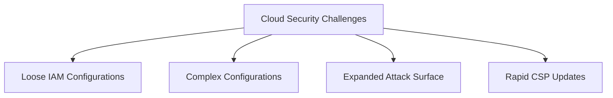

# 🔐 Cloud Security

[[Google Cybersecurity|← Back to Course Hub]] · [[2026-10-18|Related day: 2026-10-18]]

While [[Cloud Computing|cloud computing]] delivers speed, cost savings, and scalability, it introduces distinct architectural and security complexities.



---

## 🆔 Identity & Access Management (IAM)

- **Definition:** the framework of processes and technology used to manage **digital identities** and authorize resource permissions.

> [!WARNING] The Principle of Least Privilege
> A primary cloud vulnerability is the **loose configuration of user roles**. Over-permissioned roles permit unauthorized actions, dramatically widening an organization's risk profile.

---

## ⚙️ Configuration & Attack Surface

- **Complexity management** — every individual cloud service requires precise configuration to maintain compliance; migration phases are historically prone to **misconfiguration** vulnerabilities.
- **Attack surface dynamics** — deploying numerous applications increases potential entry points for malware.

> [!TIP] Good news on infrastructure
> If designed correctly, multi-service architectures do **not** inherently yield more entry points. CSPs generally enforce **default configurations** that are under much greater security scrutiny than traditional on-premises setups.

---

## 🕒 Zero-Day Attacks & Visibility

- **Zero-day advantages** — CSPs operate at a scale that lets them discover zero-day exploits **before** private enterprises do; they patch hypervisors and migrate active workloads away from threats.
- **The visibility trade-off:**
    - Cloud networks provide deep visibility via **flow logs** and **packet mirroring**.
    - Because CSPs block direct inspection of physical backend servers, they pay for **independent third-party audits** to verify systemic compliance and reveal on-premise integration gaps.

---

## 🤝 The Shared Responsibility Model

An explicit boundary defining where the **provider's** security tasks end and the **customer's** begin.

```
┌───────────────────────────────────────────────────────────┐
│               CUSTOMER: Security IN the Cloud             │
│  (Data, IAM Configurations, Apps, Operating Systems)      │
├───────────────────────────────────────────────────────────┤
│                  CSP: Security OF the Cloud               │
│  (Physical Data Centers, Hypervisors, Host Infrastructure)│
└───────────────────────────────────────────────────────────┘
```

> [!CAUTION] The assumptions trap
> Breaches frequently happen when organizations assume a CSP is securing an asset that actually falls under the **customer's** jurisdiction — e.g. leaving a database publicly exposed due to default setup oversight.

---

## 🛠️ Cloud Security Hardening Framework

A blended approach of administrative governance, physical boundary protection, and data security controls:

- **IAM enforcement** — tighten permission scopes and audit logs.
- **Hypervisor security** — rely on the provider's isolated virtual engine boundaries.
- **Baselining** — establish a trusted state of "normal" configuration and network behavior metrics to identify anomalies early.
- **Cryptography & cryptographic erasure** — encrypt active data pools; use cryptographic erasure (**destroying encryption keys**) to permanently sanitize cloud storage when decommissioning resources.

---

## 🔗 Related

- [[Cloud Computing]]
- [[Logs & SIEM]]
- [[Security Controls]]
- [[Risk Management]]
