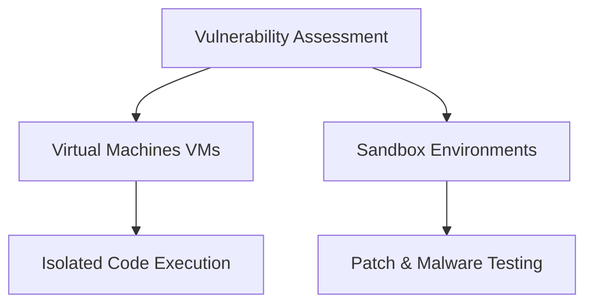

# 🧪 Vulnerability Assessment

[[Google Cybersecurity|← Back to Course Hub]] · [[2026-10-18|Related day: 2026-10-18]]

Organizations proactively identify security gaps and simulate incidents using **isolated testing environments** before a live breach occurs.

---

## 💻 Virtual Machines (VMs)

> [!INFO] Definition
> **VMs** are software-emulated versions of physical computers that run in isolated environments.

- **Isolation** — prevents malicious code from leaking into the host operating system.
- **Disposability** — can be completely deleted and replaced with a pristine image post-testing.
- **State control** — snapshot and revert to a clean, previous state.

> [!WARNING] Virtualization risk
> There is a small, persistent risk that advanced malware can perform a **virtualization escape** to access and compromise the underlying host machine.

---

## 🏜️ Sandbox Environments

- **Purpose:** isolated environments built specifically to execute untrusted software, test security patches, find bugs, and simulate attack scenarios.
- **Deployment:** can be standalone physical hardware, but cloud-based or software-driven VMs are more cost-effective.

> [!ATTENTION] Evasion tactics
> Modern malware authors write code capable of **detecting VM or sandbox environments**. If detected, the malware alters its behavior to appear completely harmless.

---

## 🛡️ Prevention & Defensive Measures

Operating system hardening requires a **defense-in-depth** approach combining cryptographic techniques and strict access management.

### Technical Controls

- **Hashing** — a one-way cryptographic function that converts data into a unique fixed-length value; it **cannot be decrypted** back to plain text.
- **Salting** — inserts random characters into the password **before** hashing, exponentially increasing hash complexity and resisting pre-computed crack lists.
- **MFA (Multi-Factor Authentication)** — requires **≥ 2 distinct authentication factors** (e.g. something you know — a password, and something you are — a fingerprint).
- **2FA** — a subset of MFA utilizing **exactly two** forms of verification.

### Perimeter & Administrative Controls

- **CAPTCHA & reCAPTCHA** — *Completely Automated Public Turing test to tell Computers and Humans Apart*; simple tasks that distinguish humans from automated scripts, blocking bot-driven brute-forcing.
- **Password policies** — standardize corporate password hygiene:
    - Complexity and character requirements
    - Maximum password age (rotation intervals)
    - Password history / reuse prohibitions
    - **Account lockout thresholds** (suspend access after *X* failed attempts)

---

## 🔗 Related

- [[Network Attacks]]
- [[Operating Systems]]
- [[Security Controls]]
- [[Common Vulnerabilities]]
- [[OWASP Security Principles]]
